<p align="center">
  
</p>

<p align="center">
  <b>Una islita en lo alto de tu pantalla</b>, cuidada por una mascota en 3D: tu música, el calendario y el clima, el sistema, tus apps, notas, herramientas, un chat con IA y los avisos de Claude Code, a un clic.
</p>

<p align="center">
  
  
  
  
  
  
</p>

<p align="center">
  <a href="https://ko-fi.com/gls726"></a>
</p>

---

## ✨ ¿Qué es?

**Komori** (en japonés, *kōmori* es «murciélago») es una **isla dinámica para Windows**: una píldora pequeña arriba al centro de la pantalla que muestra la hora, el clima y lo que suena, y que al tocarla (o al dejar el mouse encima) se abre en un panel con todo lo que usas a diario. Vive en ella una **mascota en 3D** que reacciona a lo que haces, se viste con lo que le pongas y se echa a dormir cuando no usas el mouse.

Es liviana, no tiene anuncios ni cuentas y no envía nada a ningún sitio: solo se conecta a los servicios que tú actives.

<p align="center">
  
</p>

## 📥 Descargar

1. Ve a **[Releases](../../releases/latest)** y descarga `Komori-Setup-x.x.x.exe`.
2. Ejecútalo y sigue el instalador (no pide permisos de administrador).
3. La isla aparece arriba al centro. Clic derecho en el ícono de la bandeja para abrir **Ajustes**.

> Windows puede mostrar el aviso *«Windows protegió su PC»* porque el instalador no tiene firma de pago. Pulsa **Más información → Ejecutar de todas formas**.

Komori se actualiza solo: cuando hay una versión nueva te avisa en la isla y la instalas desde **Ajustes → Acerca de**.

## 🖼️ Capturas

| Inicio | Música |
|:---:|:---:|
| 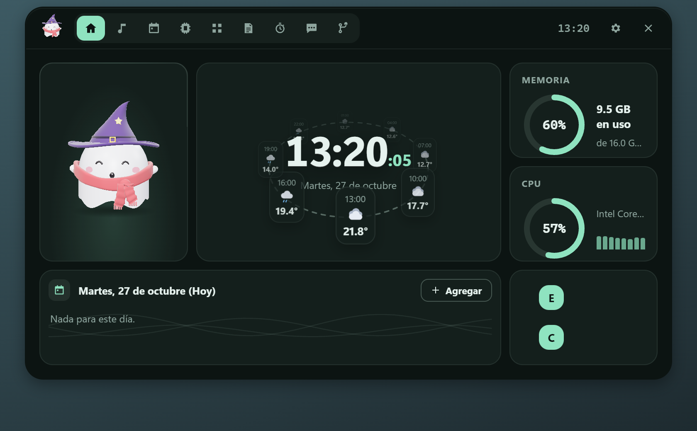 | 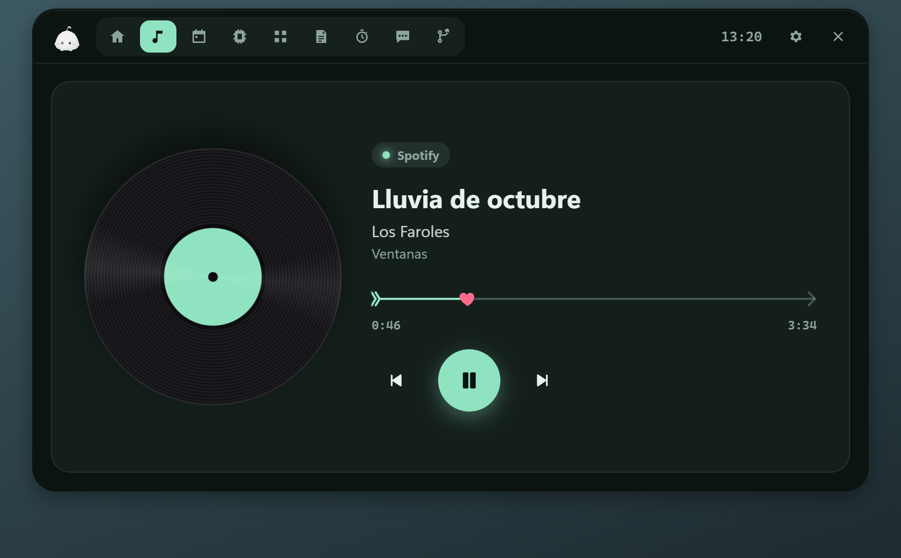 |
| **Calendario y clima** | **Sistema** |
| 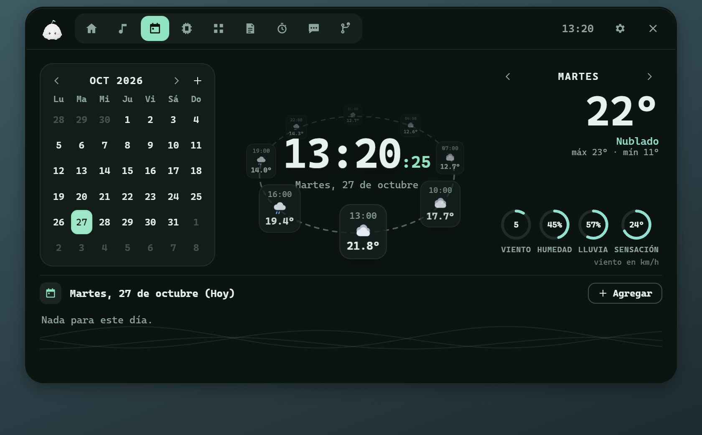 | 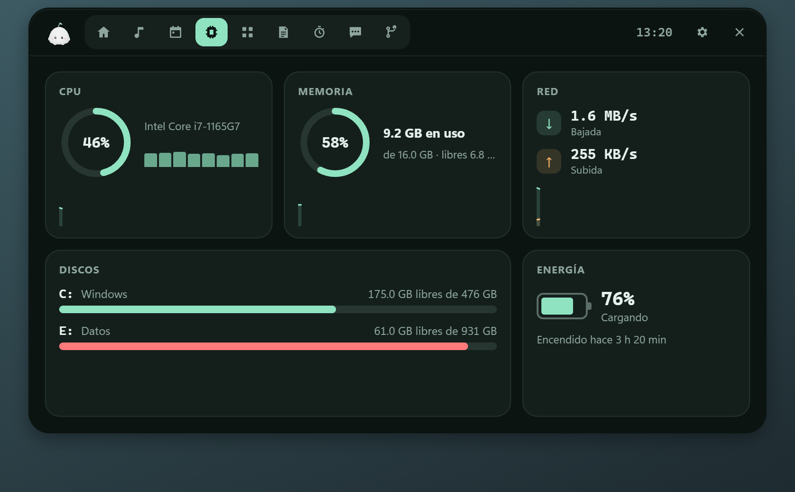 |
| **Herramientas** | **Chat con IA** |
| 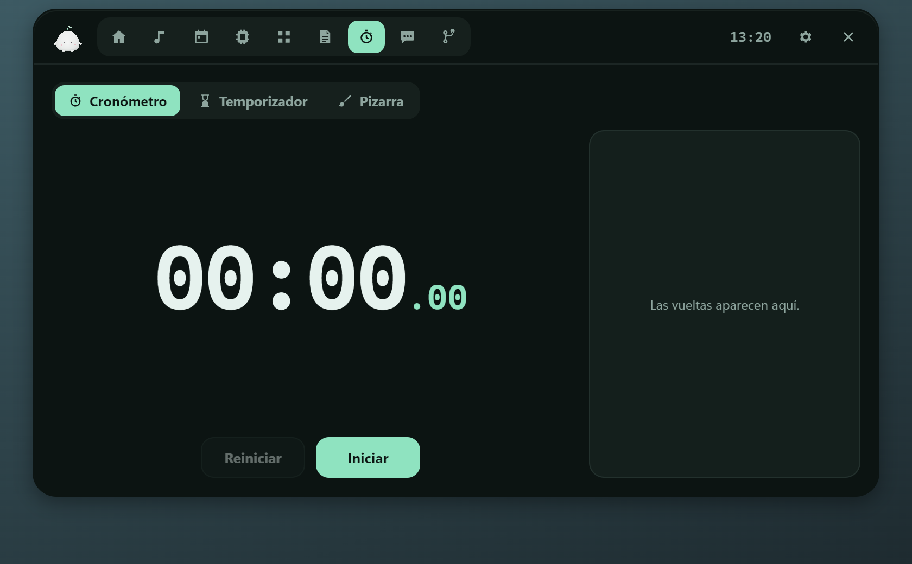 |  |
| **Tema claro y borde de color** | **Forma pegada arriba** |
| 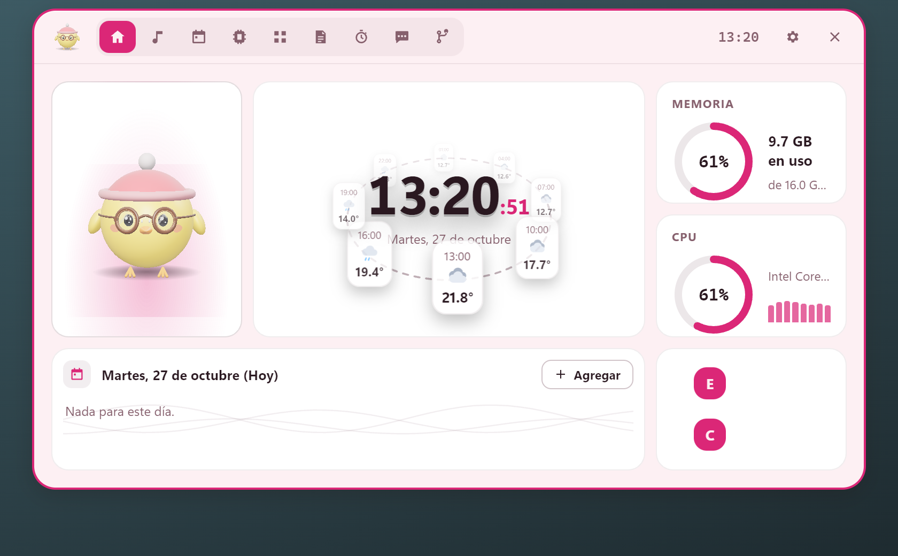 |  |
| **Ajustes: tu mascota** | **Guardarropa** |
| 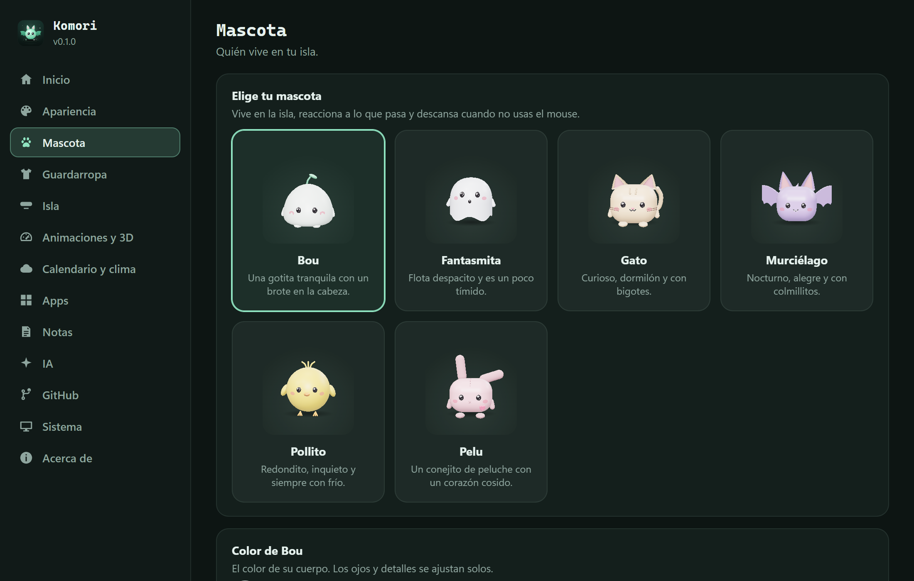 |  |
| **Animaciones y 3D** | **Apariencia** |
| 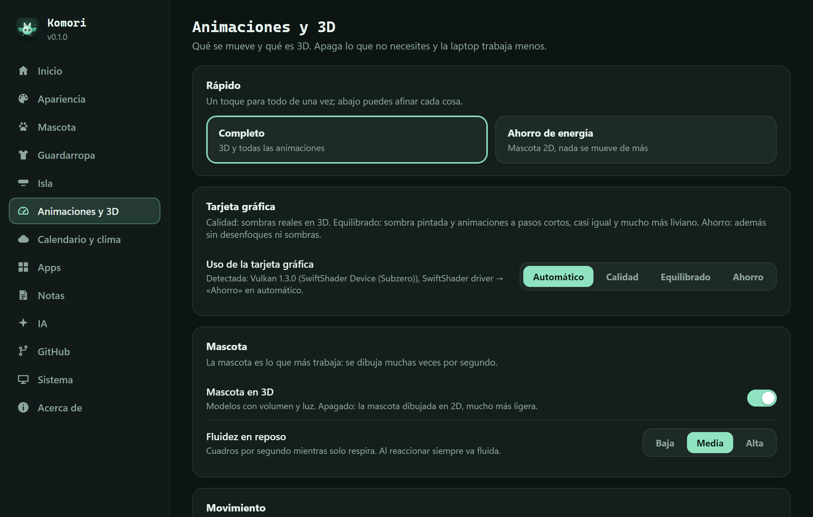 | 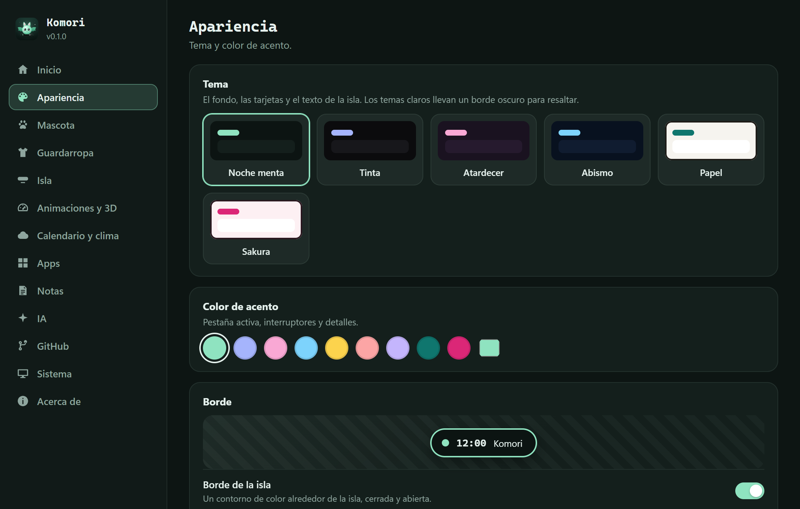 |
| **Editor de Inicio** | **Acerca de** |
| 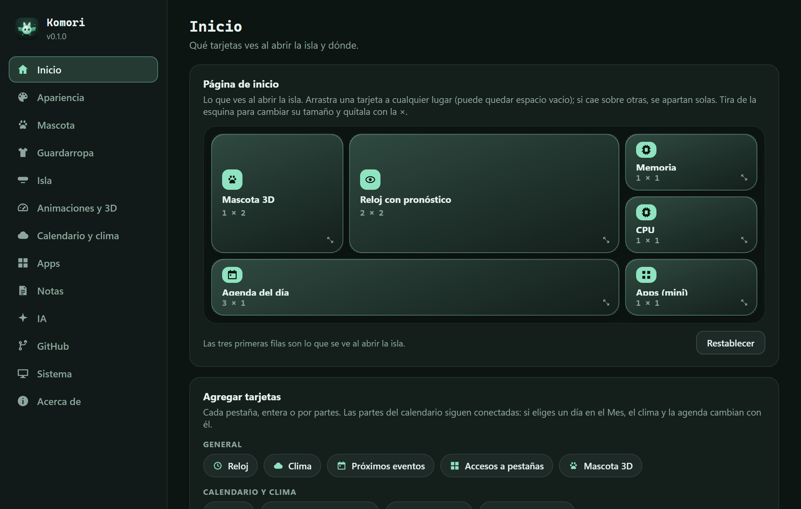 | 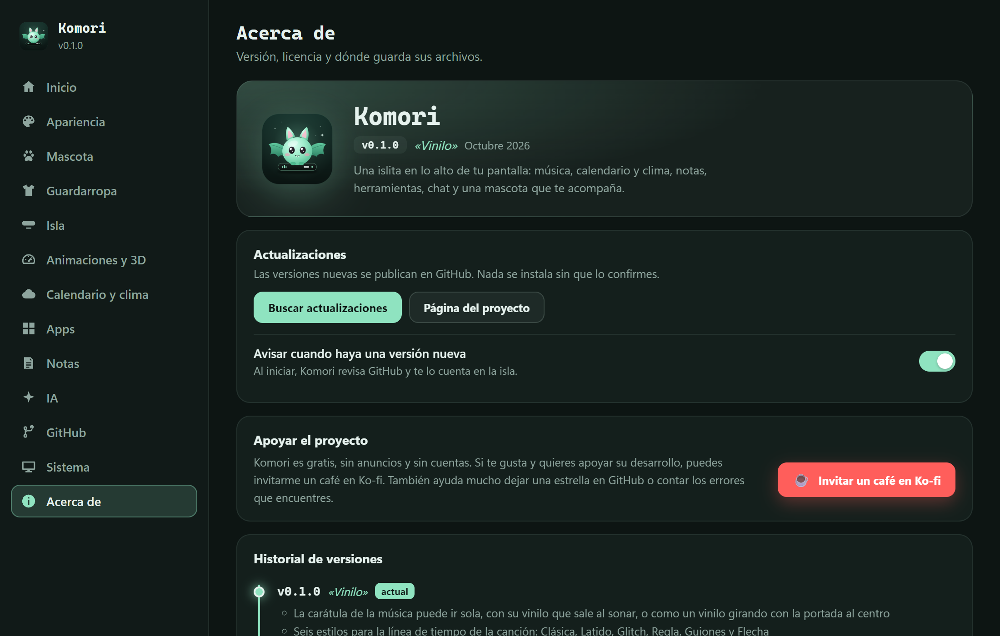 |

## 🚀 Características

### 🐾 Tu mascota
- **Seis mascotas en 3D** con volumen, luz y sombras suaves: **Bou**, **Fantasmita**, **Gato**, **Murciélago**, **Pollito** y **Pelu**, cada una del color que quieras.
- **Estados de ánimo**: se alegra al abrir la isla, se asoma con curiosidad, hace puchero si la tocas mucho, se marea, se toma un café y **se duerme** cuando no usas el mouse. Con bracitos que acompañan cada gesto y **sonidos propios** (que puedes apagar).
- **Sigue al mouse** con la mirada (opcional).
- **Guardarropa** de 18 accesorios —gorro de lana, gorras, capucha, corona, sombrero de bruja, auriculares, gafas, mascarilla, bufanda, pañuelo…— que se ajustan a la forma de cada mascota.

### 🏝️ La isla
- **Cerrada**: hora, clima, la canción que suena con ecualizador y tus notificaciones de GitHub. Su ancho se adapta a lo que muestra.
- **Abierta**: pestañas de Inicio, Música, Calendario y clima, Sistema, Apps, Notas, Herramientas, Chat y GitHub. Elige cuáles ver y en qué orden.
- Se abre con un clic o **al dejar el mouse encima**; flotante o **pegada al borde de arriba** con dos curvas.
- **Inicio a tu medida**: arma tu propio tablero con cualquier pieza de las pestañas (mascota grande, reloj con pronóstico, medidores, agenda, mini reproductor, temporizador…) y acomódalo arrastrando.

### 🎵 Música
- Controla lo que suene en **Spotify, el navegador o cualquier reproductor de Windows**: portada, título, avance y controles.
- La carátula puede ir sola, con **su vinilo** que sale al sonar o como **vinilo girando**.
- **Seis estilos de línea de tiempo**: Clásica, Latido, Glitch, Regla, Guiones y Flecha.

### 📅 Calendario y clima
- Mes, **reloj con el pronóstico en órbita 3D**, clima del día con anillos (viento, humedad, lluvia, sensación) y agenda con **recordatorios** a su hora.
- Clima de [Open-Meteo](https://open-meteo.com): sin cuenta y sin clave.

### 🧰 Y además
- **Sistema**: procesador, memoria, discos, red y batería.
- **Apps**: tus accesos directos a programas, carpetas, webs o apps de la Tienda, con sus íconos.
- **Notas** rápidas guardadas como `.txt`.
- **Herramientas**: cronómetro con vueltas, temporizador y pizarra de dibujo.
- **Chat con IA**: Claude, cualquier servicio compatible con OpenAI (OpenRouter, Groq, Gemini, LM Studio…) u **Ollama en tu PC, gratis y sin clave**.
- **GitHub**: notificaciones, revisiones pendientes y tus pull requests.
- **Avisos de Claude Code**: la isla te avisa cuando Claude termina una tarea, te hace preguntas o necesita permiso, con un botón para ir directo a su ventana.

### 🎨 A tu gusto
- Seis temas (oscuros y claros), color de acento y **borde de color** para la isla.
- **Animaciones y 3D**: elige qué se mueve, la fluidez de la mascota y cuánto usar la **tarjeta gráfica** (Automático, Calidad, Equilibrado o Ahorro). Con **Ahorro de energía**, Komori casi no consume.
- Solo se dibuja lo que se ve: con la isla cerrada, el panel no trabaja.

## 🔒 Tus datos

- No hay telemetría. Komori solo habla con los servicios que tú activas: el clima, GitHub, el chat que elijas y la búsqueda de versiones nuevas.
- Las **claves de IA y el token de GitHub** se guardan en el **Administrador de credenciales de Windows**, nunca en un archivo. La interfaz puede guardarlas o borrarlas, pero nunca leerlas.
- Tus preferencias, notas y dibujos viven en `%APPDATA%\Komori`.

## 🛠️ Compilar desde el código

Requisitos: [Rust](https://rustup.rs), [Node.js 20+](https://nodejs.org) y las Visual Studio Build Tools («Desarrollo para el escritorio con C++»).

```powershell
npm install
npm run tauri dev   # versión de desarrollo con recarga en vivo
npm run pack        # instalador en src-tauri/target/release/bundle/nsis/
```

`npm run dev` sirve solo la interfaz en un navegador normal, suficiente para trabajar en cómo se ve (`?demo` simula un reproductor).

## 🧩 Hecho con

[Tauri](https://tauri.app) · [three.js](https://threejs.org) · [Open-Meteo](https://open-meteo.com) · [sysinfo](https://github.com/GuillaumeGomez/sysinfo)

## ☕ Apoyar el proyecto

Komori es gratis, sin anuncios y sin cuentas. Si te gusta y quieres apoyar su desarrollo, puedes **[invitarme un café en Ko-fi](https://ko-fi.com/gls726)** 💚. También ayuda mucho dejar una ⭐ en el repositorio o contar en *Issues* los errores que encuentres.

## 📄 Licencia

Código abierto bajo la [licencia MIT](LICENSE). Las mascotas, los accesorios, los sonidos y los íconos son diseños originales de este proyecto.

---

<p align="center">Hecho con 💚 para que tu escritorio tenga compañía.</p>
